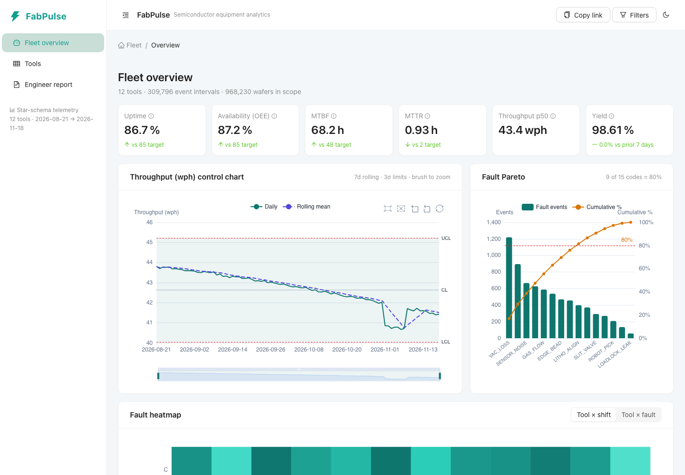
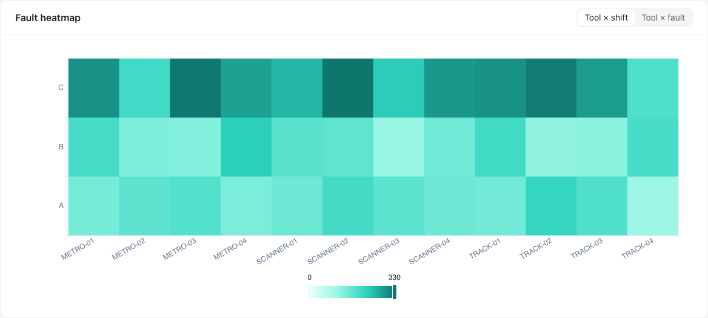
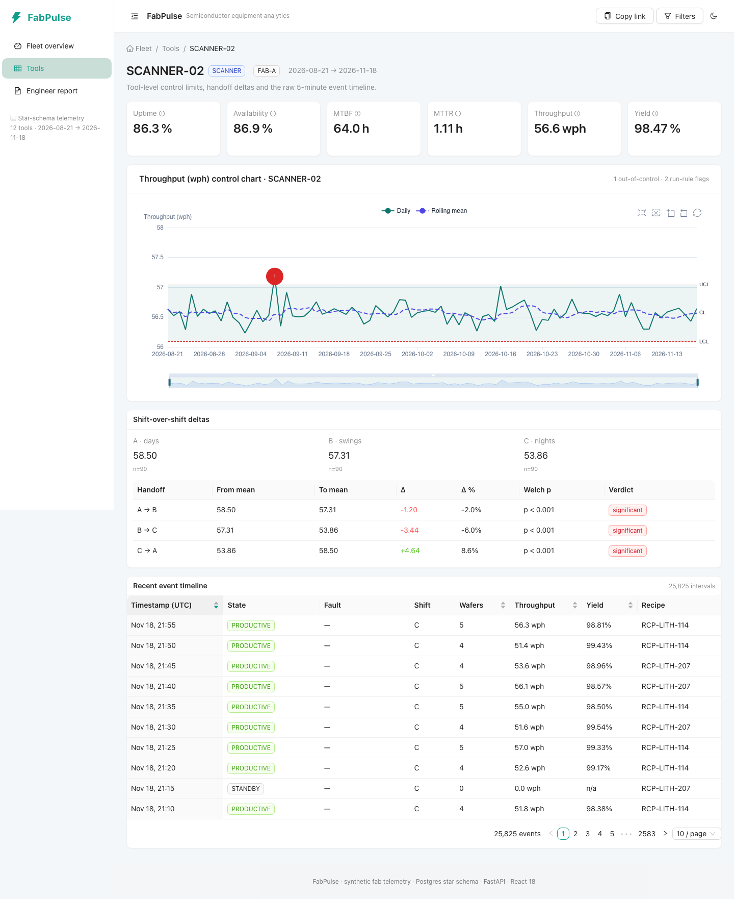
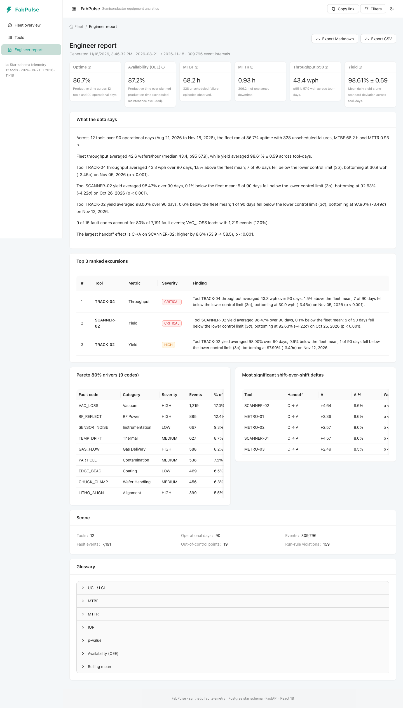
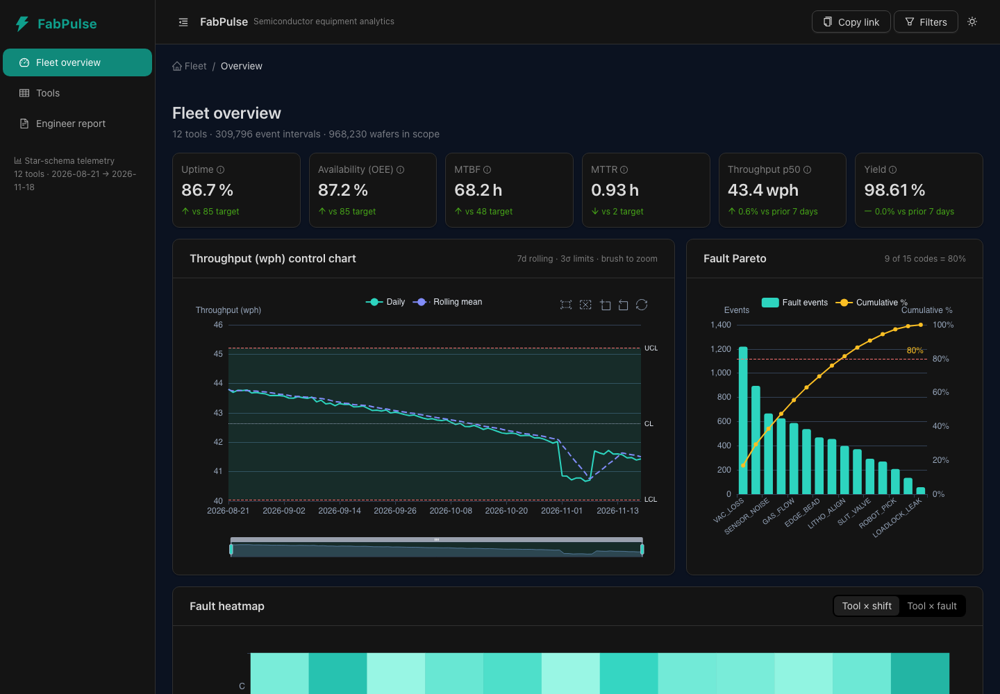
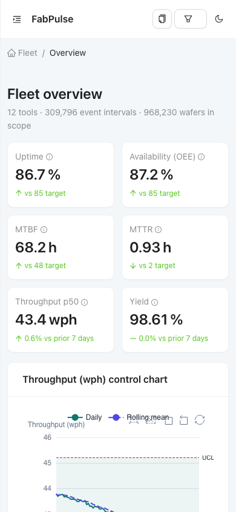

# FabPulse

**An industrial equipment analytics console for semiconductor-fab-style machine telemetry.**
FabPulse ingests raw tool logs, loads a PostgreSQL star schema, computes SPC-style
statistics (rolling means, 3σ control limits, Western-Electric run rules, Tukey
outliers, Pareto drivers, shift handoff deltas), serves them through a typed
FastAPI API, and renders an Ant Design + ECharts console with shareable URLs and
an exportable engineer report.

The problem it solves: fab engineers have plenty of raw equipment events but
little time to turn them into decisions. FabPulse replaces ad-hoc spreadsheet
analysis with one reproducible pipeline from dirty raw logs to a plain-language
summary a non-specialist stakeholder can read.

## Screenshots









<p>
  
  
</p>

## Architecture

```
 data/generate.py ──► data/raw/equipment_events.{csv,parquet}
      311,351 rows · 12 tools · 3 shifts · 90 days · 0.5% dirty
                              │
                              ▼
 fabpulse.ingest ────────► RejectReport (1,555 rows, 5 reasons)
   pandas validation, duplicate removal, UTC parsing
                              │
                              ▼
 PostgreSQL 15 star schema                 (SQLite fallback: data/fabpulse.db)
   dim_tool · dim_date · dim_shift · dim_fault · fact_tool_event
   309,796 fact rows · 4 indexes
                              │
                              ▼
 fabpulse.stats  ◄── fabpulse.queries (all heavy SQL)
   SQL: counts, sums, group means, LAG-window failure episodes
   pandas/NumPy: rolling stats, control limits, run rules, percentiles,
                 Tukey fences, Welch t-test, Pareto accumulation
                              │
                              ▼
 FastAPI + Pydantic v2 (shared FilterParams dependency, 10 endpoints)
                              │
                              ▼
 React 18 + TypeScript + Ant Design 5 + ECharts 5 + Vite
   URL-encoded filters · drill-down · light/dark theme · CSV/Markdown export
```

### Star schema (ERD)

```
        dim_date                      dim_tool
  ┌──────────────────┐          ┌────────────────────┐
  │ date_key  PK     │          │ tool_key   PK      │
  │ date, year, month│          │ tool_id    UQ      │
  │ iso_week, dow    │          │ tool_family, site  │
  │ is_weekend       │          │ install_date       │
  └────────┬─────────┘          └─────────┬──────────┘
           │                              │
           │        fact_tool_event       │
           │  ┌────────────────────────┐  │
           └─►│ event_key     PK       │◄─┘
              │ tool_key      FK       │
     dim_shift│ date_key      FK       │
  ┌──────────┐│ shift_key     FK       │
  │shift_key ││ fault_key     FK null  │
  │code A/B/C││ ts (UTC)               │
  │start,end ││ state                  │
  └────┬─────┘│ wafers_processed       │
       └─────►│ throughput_wph         │
              │ yield_pct (nullable)   │
     dim_fault│ duration_s             │
  ┌──────────┐│ recipe_id (degenerate) │
  │fault_key │└────────────────────────┘
  │code,cat  │
  │severity  │  Indexes: (tool_key, ts), (date_key, shift_key),
  └────┬─────┘           (fault_key), (state)
       └────►
```

`date_key` is the **operational date**: night-shift intervals before 06:00 UTC
are attributed to the previous day so a shift never straddles two analytical
days.

### API endpoints

| Method | Path                          | Purpose                                                       |
| ------ | ----------------------------- | ------------------------------------------------------------- |
| GET    | `/api/health`                 | Service status, active backend, warehouse row count           |
| GET    | `/api/meta/filters`           | Tools, families, sites, shifts, fault vocabulary, date bounds |
| GET    | `/api/kpis`                   | Fleet KPIs + server-paged/sorted per-tool KPI table           |
| GET    | `/api/timeseries`             | Daily series, rolling mean/std, UCL/LCL, violations           |
| GET    | `/api/boxplot`                | Per-tool five-number summaries, IQR fences, Tukey outliers    |
| GET    | `/api/pareto`                 | Fault counts, percentages, cumulative %, 80% cutoff codes     |
| GET    | `/api/heatmap`                | Fault counts by tool × shift and tool × fault code            |
| GET    | `/api/shifts/delta`           | Shift means and Welch-tested handoff comparisons              |
| GET    | `/api/tools/{tool_id}/events` | Server-paged/sorted event timeline drill-down                 |
| GET    | `/api/report/summary`         | Plain-language engineer report for the current filters        |

All analytical endpoints share `from_date`, `to_date`, `tool_ids[]`,
`tool_family`, `fab_site`, `shifts[]` and `metric`. Bad filters return `400`;
unknown tools return `404`. The OpenAPI contract is committed at
`api/openapi.json` and refreshed with `make snapshot`.

### Where the statistics live

| Function                 | Method                                                       | Implementation                                                      |
| ------------------------ | ------------------------------------------------------------ | ------------------------------------------------------------------- |
| `availability_kpis`      | Uptime, OEE availability, MTBF, MTTR                         | SQL duration sums + `LAG` window failure episodes; ratios in pandas |
| `rolling_series`         | 7-day rolling mean/std                                       | pandas `.rolling()`                                                 |
| `control_limits`         | Center line, UCL/LCL at mean ± kσ                            | NumPy sample std; rule engine in `detect_run_rules`                 |
| run rules                | 1 beyond 3σ, 8 same side, 2-of-3 beyond 2σ, 4-of-5 beyond 1σ | Pure Python/NumPy in `stats.py`                                     |
| `percentiles_outliers`   | p5/p25/p50/p75/p95, Tukey fences, outliers                   | NumPy percentile + 1.5×IQR                                          |
| `shift_over_shift_delta` | A→B, B→C, C→A means, Δ, Δ%, Welch t-test                     | SQL grouped means; Welch + normal-approx p in NumPy                 |
| `fault_pareto`           | Counts, %, cumulative %, 80% cutoff                          | SQL `COUNT/GROUP BY`; accumulation in pandas                        |
| `fault_heatmap`          | tool × shift, tool × fault counts                            | SQL grouped counts; pandas pivot                                    |

Heavy grouping is in `api/fabpulse/queries.py`; distributional math is in
`api/fabpulse/stats.py`. There is no scipy dependency: Welch's t-statistic is
implemented directly and its two-sided p-value uses the normal approximation
(`erfc(|t|/√2)`), documented in the function docstring.

## How to run

### Prerequisites

- Python 3.11+
- Node.js 20.19+ (or 22.12+) and npm
- PostgreSQL 15+ **optional** — without it the backend falls back to SQLite

### Quick start

```bash
git clone <your-repo-url> FabPulse
cd FabPulse
make setup          # .venv + Python deps + npm ci
make gen            # writes data/raw/equipment_events.{csv,parquet}
make ingest         # creates the schema and loads the warehouse
make api            # FastAPI on http://127.0.0.1:8000
make web            # Vite on http://localhost:5173
```

Open <http://localhost:5173>. The Vite dev server proxies `/api` to port 8000.
The API docs are at <http://127.0.0.1:8000/docs>.

### Configuration

| Variable                | Default                                        | Meaning                                    |
| ----------------------- | ---------------------------------------------- | ------------------------------------------ |
| `FABPULSE_DATABASE_URL` | unset                                          | Explicit SQLAlchemy URL; overrides probing |
| `FABPULSE_POSTGRES_URL` | `postgresql+psycopg://localhost:5432/fabpulse` | Postgres DSN probed when no explicit URL   |
| `FABPULSE_CORS_ORIGINS` | `http://localhost:5173,http://127.0.0.1:5173`  | Allowed browser origins                    |
| `VITE_API_BASE`         | empty (same origin)                            | Point the web app at a remote API          |

`api/.env.example` documents the same values. To point at a database:

```bash
createdb fabpulse
export FABPULSE_DATABASE_URL="postgresql+psycopg://localhost:5432/fabpulse"
make ingest
```

**Postgres → SQLite fallback.** When `FABPULSE_DATABASE_URL` is unset, FabPulse
probes the Postgres DSN with a 2-second timeout. If nothing answers, it uses
`data/fabpulse.db` through the same SQLAlchemy Core tables, SQL and code path.
The SQL is deliberately dialect-neutral; only timestamp tz-awareness differs
(SQLite stores naive UTC). `connect_args`, autoincrement handling and timezone
storage are the only backend-specific branches.

### Tests, lint and CI

```bash
make test     # pytest + vitest
make lint     # eslint + prettier check
make ci       # local reproduction of the GitHub Actions python + web jobs
```

`make ci` generates a reduced 20-day dataset into `data/ci-raw`, loads a
dedicated SQLite CI warehouse, runs pytest with coverage and the module
coverage gate, then runs `tsc --noEmit`, ESLint, Vitest with coverage and the
production build.

### Reports and benchmarks

```bash
python scripts/export_report.py --format md --out reports/
python scripts/bench_api.py --iterations 20
```

Filters are accepted by the exporter (`--from-date`, `--to-date`,
`--tool-family`, `--fab-site`, `--tool-ids`, `--shifts`, `--metric`).

## Results

Every number below was produced in this build session. The generator is
seeded, so rerunning on the same end date reproduces the dataset exactly.

### Generated data and ingestion

| Measurement               |                                                                                                            Value |
| ------------------------- | ---------------------------------------------------------------------------------------------------------------: |
| Raw rows generated        |                                                                                                      **311,351** |
| Raw files                 |                                                                                   CSV 32.89 MB · Parquet 4.94 MB |
| Operational window        |                               **2026-08-21 → 2026-11-18** (90 days, raw timestamps through 2026-11-19 05:55 UTC) |
| Tools / families / shifts |                                                                                                   **12 / 3 / 3** |
| Rows loaded               |                                                                                                      **309,796** |
| Rows rejected             |                                                                                                **1,555** (0.50%) |
| Rejections by reason      | duplicate_event_id 311 · null_timestamp 311 · negative_duration 311 · out_of_range_yield 311 · unknown_state 311 |
| Ingestion wall time       |                                                                                                       **9.88 s** |
| Ingestion throughput      |                                                                                                **31,343 rows/s** |
| Idempotency               |                                                     Two `--truncate` runs produce identical counts and checksums |

Warehouse on disk (PostgreSQL 16 local server):

| Table / object                                   | Rows / size |
| ------------------------------------------------ | ----------: |
| `dim_tool`                                       |          12 |
| `dim_date`                                       |          90 |
| `dim_shift`                                      |           3 |
| `dim_fault`                                      |          15 |
| `fact_tool_event`                                | **309,796** |
| Database size                                    |   **66 MB** |
| `fact_tool_event` total (heap + TOAST + indexes) |   **57 MB** |
| Fact indexes                                     |   **22 MB** |

### Fleet KPIs

| Metric                                             |                   Value |
| -------------------------------------------------- | ----------------------: |
| Uptime                                             |             **86.710%** |
| Availability (OEE, scheduled maintenance excluded) |             **87.206%** |
| Unscheduled failure episodes                       |                 **328** |
| MTBF                                               |            **68.248 h** |
| MTTR                                               |             **0.933 h** |
| Productive hours                                   |               22,385.25 |
| Unscheduled down hours                             |                 306.167 |
| Wafers processed                                   |                 968,230 |
| Throughput p50 / p95 (tool-days)                   | **43.402 / 57.903 wph** |
| Mean daily yield                                   |      **98.611% ± 0.59** |

### Control charts and excursions

Across the per-tool throughput and yield charts the API/report detected
**19 out-of-control points** and **159 run-rule violations** (summarised in
`/api/report/summary`).

| Tool / metric                               | Out-of-control points |                Worst deviation | Run-rule violations |
| ------------------------------------------- | --------------------: | -----------------------------: | ------------------: |
| TRACK-04 throughput                         |                 **7** | **−3.454σ** (30.91 wph, Nov 5) |                  21 |
| SCANNER-02 yield                            |                 **5** |   **−4.223σ** (92.63%, Oct 26) |                  19 |
| TRACK-02 yield                              |                     1 |       −3.486σ (97.90%, Nov 12) |                   3 |
| SCANNER-03 throughput (gradual degradation) |                     0 |                              — |              **35** |
| TRACK-02 throughput (gradual degradation)   |                     0 |                              — |              **35** |
| METRO-04 throughput (gradual degradation)   |                     0 |                              — |              **34** |
| METRO-01 throughput                         |                     1 |                        −3.130σ |                   1 |
| METRO-03 throughput                         |                     1 |                        +3.432σ |                   1 |
| SCANNER-02 throughput                       |                     1 |                        +3.872σ |                   2 |
| METRO-03 yield                              |                     1 |                        −3.059σ |                   1 |
| SCANNER-01 yield                            |                     1 |                        +3.003σ |                   3 |
| TRACK-04 yield                              |                     1 |                        +3.318σ |                   1 |

The three degraded tools show **zero single-day 3σ points but 34–35 run-rule
flags** — exactly the sustained drift that a naive "only flag 3σ points" check
would miss.

### Pareto

**9 of 15 fault codes account for 80%** of 7,191 fault events:

`VAC_LOSS` (1,219 events, 17.0%) · `RF_REFLECT` (895) · `SENSOR_NOISE` (667) ·
`TEMP_DRIFT` (627) · `GAS_FLOW` (588) · `PARTICLE` (538) · `EDGE_BEAD` (469) ·
`CHUCK_CLAMP` (456) · `LITHO_ALIGN` (399).

### Strongest shift-over-shift delta

`SCANNER-02`, **C → A**: **53.862 → 58.502 wph (+8.615%)**, Welch
t = −145.33, **p < 0.001**. B → C on the same tool is −6.0% (p < 0.001).
Shifts A/B/C are 06:00–14:00, 14:00–22:00 and 22:00–06:00 UTC.

### Tests, coverage and CI

| Suite  |                   Tests |          Runtime | Coverage                                                                       |
| ------ | ----------------------: | ---------------: | ------------------------------------------------------------------------------ |
| pytest |           **47 passed** |       **4.01 s** | total **90%**; `stats.py` **94%**, `ingest.py` **94%**                         |
| Vitest | **39 passed** (7 files) | ~6.5 s test time | charts+hooks: **98.59% stmts / 87.87% branches / 98.66% funcs / 99.41% lines** |

CI job runtimes, measured by running the workflow steps locally (`make ci`):

| Job                                                         | Local wall time |
| ----------------------------------------------------------- | --------------: |
| python (generate 20-day → ingest → pytest → coverage gate)  |      **7.67 s** |
| web (typecheck → lint → Vitest coverage → production build) |     **15.76 s** |
| `make ci` total (both jobs + generator + ingest)            |     **23.28 s** |

GitHub Actions itself was not executed because this build has no remote; the
workflow is `.github/workflows/ci.yml` and `make ci` runs the same commands.
CI uses a `postgres:15` service container for the python job and Node 20 for
the web job.

### Frontend bundle and API latency

`npm run build`: **2,271.74 kB** JavaScript (**725.52 kB gzip**), 0.67 kB CSS.

`scripts/bench_api.py --iterations 20` against the local API + PostgreSQL:

| Endpoint                 |    p50 ms |      p95 ms |      max ms |
| ------------------------ | --------: | ----------: | ----------: |
| `/api/health`            |      13.3 |        15.1 |        17.6 |
| `/api/meta/filters`      |       4.1 |         4.9 |         5.0 |
| `/api/kpis`              |     588.0 |       684.8 |       692.4 |
| `/api/timeseries`        |     279.7 |       333.5 |       338.6 |
| `/api/boxplot`           |     137.0 |       165.7 |       171.2 |
| `/api/pareto`            |      53.1 |        62.8 |        68.0 |
| `/api/heatmap`           |      61.3 |        79.1 |        96.1 |
| `/api/shifts/delta`      |     217.1 |       408.4 |       494.5 |
| `/api/tools/{id}/events` |      30.1 |        34.0 |        58.0 |
| `/api/report/summary`    |   1,813.7 |     1,900.8 |     1,977.5 |
| **overall**              | **111.9** | **1,812.9** | **1,977.5** |

The report endpoint dominates the tail because it runs eight full-window
aggregations and ranks every tool/metric pair. All other endpoints stay at or
below **684.8 ms p95**.

## Engineering notes

### Performance fix: defer fact-index maintenance during bulk load

The first implementation created the four fact indexes before inserting
309,796 rows, so PostgreSQL maintained each B-tree on every one of the ~31
10k-row batches. I measured three baseline runs, changed
`load_warehouse()` to drop the fact indexes before the insert transaction and
recreate them once afterwards, then measured three more:

| Run        | Before (wall) | Before (rows/s) | After (wall) | After (rows/s) |
| ---------- | ------------: | --------------: | -----------: | -------------: |
| 1          |       11.15 s |          27,776 |       9.74 s |         31,799 |
| 2          |       11.11 s |          27,873 |       9.78 s |         31,681 |
| 3          |       10.81 s |          28,654 |       9.52 s |         32,553 |
| **Median** |   **11.11 s** |      **27,873** |   **9.74 s** |     **31,799** |

That is **12.3% less wall time** and **14.1% more rows/second**, with identical
row counts and checksums (the idempotency test covers it). The indexes are
restored in a `finally` block so a failed load never leaves an unindexed table.
The same code path runs on SQLite.

Two correctness fixes found while building the charts:

- `echarts-for-react@3.1.0` waits for a `finished` event before calling
  `setOption`, which never fires in headless/offscreen rendering. Pinning
  **3.0.2** fixed blank charts in the browser and in screenshots.
- Daily throughput originally used `SUM(wafers) × 3600 / SUM(duration)`.
  Because wafers are integer counts per 5-minute interval, that quantised the
  series at 12 wph and made shift C look artificially worse. Switching the SQL
  metric to the mean productive `throughput_wph` restored the signal
  (C→A is 8.6%, matching the generator's 1.02/0.94 shift factors).

## Limitations and next steps

- **Synthetic data.** The generator injects deliberate degradations and dirty
  rows; it is not a validated process model.
- **Batch-only ingestion.** Loading 310k rows takes ~10 s. Real fabs would use
  streaming ingest (Kafka/OPC-UA/MQTT), incremental loads and late-arriving-row
  handling.
- **Per-request aggregation.** KPIs and the report scan the fact table on every
  request. Materialised daily aggregates (or a TimescaleDB continuous
  aggregate) would cut p95 latency, especially for `/api/report/summary`.
- **SPC scope.** Four Western-Electric rules are implemented; EWMA/CUSUM
  charts and per-chamber limits are not.
- **Statistics.** Welch's p-value uses a normal approximation (no scipy); this
  is accurate at this sample size but should be replaced by a t-distribution
  for small samples. The Pareto counts intervals, so a 20-minute downtime block
  contributes four events; a dwell-time-weighted Pareto would be a useful
  variant.
- **Security and tenancy.** There is no authentication, authorisation or
  per-site row-level security. Add OIDC + site scoping before exposing it.
- **SQLite fallback.** It is for laptop demos, not production: weaker typing,
  foreign keys not enforced by default, single-writer concurrency.
- **Frontend bundle.** 2.27 MB (725 kB gzip) is heavy because Ant Design and
  ECharts are fully imported. Route-level code splitting and ECharts tree
  shaking are the obvious next step.
- **UI scope.** Filters, drill-down and report export are implemented; there is
  no alerting/notification workflow yet.

## Repository layout

```
api/fabpulse/     config, db, schema, ingest, queries, stats, report, API
api/tests/        pytest suites (ingestion, stats, API, report/export)
data/generate.py  seeded synthetic equipment log generator
data/raw/         generated CSV + Parquet (gitignored)
reports/          generated Markdown, CSV and JSON engineer reports
scripts/          schema.sql writer, OpenAPI snapshot, report exporter, API bench
web/src/          React 18 console (api, charts, hooks, layout, pages, report)
docs/             screenshots and architecture decisions
```

## Contributing

See [CONTRIBUTING.md](CONTRIBUTING.md) for commit, PR and review conventions,
and [docs/DECISIONS.md](docs/DECISIONS.md) for the five architecture decision
records behind the stack.
